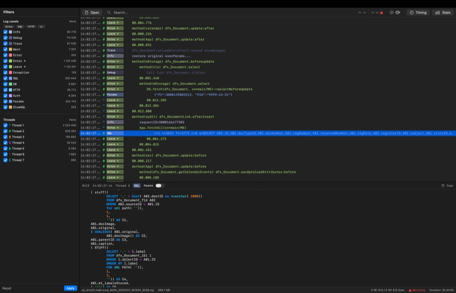

# Logram

Native cross-platform UnityBase log analyzer for **macOS**, **Windows** and **Linux**.

Opens multi-gigabyte UB server logs and turns them into a readable stream with filters, method timing, SQL highlighting, and cust1 parameter substitution.

**[logram.perek.rest](https://logram.perek.rest)** &middot; [Download latest release](https://github.com/qwq-qwq/Logram/releases/latest) &middot; [Changelog](CHANGELOG.md)



---

## Features

- **4 log formats** auto-detected: mORMot 1, mORMot 2 HiRes, journald, console
- **32 UB log levels** with colored badges in the log and color squares in the filter sidebar
- **Filter by level and thread** with one-click presets (All, Errors, SQL, HTTP, +/-)
- **Sticky focus** — the selected line stays selected and centered when filter checkboxes are toggled
- **Focus on Call** — Ctrl/Cmd+Shift+E narrows the view to the enclosing `+/-` pair on the same thread
- **Method timing** pairs `+` and `-` entries, sorted by duration (top 1000); the duration comes from the `-` line itself, and for calls longer than 99 s (UB caps the value) from the line timestamps; calls with no matching `-` (hung, still running, or cut off by the end of the log) are listed separately as open
- **Statistics** events/sec, distribution by level, HTTP/SQL counts
- **SQL highlighting** with cust1 parameter substitution
- **Tabs** native macOS window tabs (Cmd+N)
- **Themes** Tokyo Night and TTY
- **Keyboard-driven** Cmd/Ctrl+J (jump to pair), Cmd/Ctrl+Shift+E (focus on call), Cmd/Ctrl+C (copy); on Windows and Linux also F3 (find next) and Ctrl+Shift+↓/↑ (next/prev error)
- **Drag & drop** log files into the window (macOS and Windows)
- **Auto-updates** on macOS via Sparkle

## Install

Builds for all three platforms are attached to the [latest release](https://github.com/qwq-qwq/Logram/releases/latest).

- **macOS**: unzip `Logram-macos.zip` and drag `Logram.app` to `/Applications`. The app is signed and notarized; it updates itself (`Logram → Check for Updates…` for a manual check)
- **Windows**: unzip `Logram-windows.zip` and run `Logram.exe` (portable, no installer)
- **Linux**: `sudo apt install ./Logram-linux.deb` (Ubuntu 24.04+ or another Debian-based distro with GTK 4.14+); remove with `sudo apt remove logram`

Full user guide: [logram.perek.rest/en/docs](https://logram.perek.rest/en/docs/).

## Architecture

Three independent native implementations sharing the same parser logic and feature set. The C++ core (`LogramWin/src/core`, `LogramWin/src/sql`) is reused verbatim by the Linux build.

| | macOS | Windows | Linux |
|---|---|---|---|
| Language | Swift 5.9 | C++20 | C++20 |
| UI | SwiftUI + NSTableView | Win32 + Direct2D + DirectWrite | GTK4 + GtkColumnView |
| Log table | NSViewRepresentable | Custom D2D control, 60fps | GListModel virtualization |
| File I/O | Data(mappedIfSafe) | Memory-mapped (MapViewOfFile) | mmap(2) |
| Line struct | LogLine (~120 bytes) | LogLineHot (20 bytes SoA) | LogLineHot (shared with Win) |
| Parsing | async chunks + Task.yield | std::jthread × CPU cores | std::jthread × CPU cores |
| Detail panel | SwiftUI | RichEdit + manual highlighting | GtkTextView + tags |
| Binary size | ~1.2 MB (.app) | ~440 KB (.exe) | ~500 KB |

## Build

### macOS

```bash
open Logram.xcodeproj
# or
xcodebuild -scheme Logram -configuration Release build
```

Requires macOS 14+, Xcode 15+.

### Windows

```bash
cd LogramWin
cmake -B build -G "Visual Studio 17 2022" -A x64
cmake --build build --config Release
```

Requires Windows 10+, Visual Studio 2022, x64 only.

### Linux

```bash
sudo apt install build-essential cmake ninja-build pkg-config libgtk-4-dev
cd LogramLinux
cmake -B build -G Ninja -DCMAKE_BUILD_TYPE=Release
cmake --build build
./build/Logram
```

Requires Ubuntu 24.04+ (or any distro with GTK 4.14+).

## UB Log Format

```
YYYYMMDD HHMMSSZZ  T level  <TAB>message
```

- `HHMMSSZZ` hours, minutes, seconds; `ZZ` is milliseconds shifted right by 4 bits (`ms shr 4`): values 00..62 in 16 ms steps, not centiseconds
- The time column shows `ZZ` as written in the log: `08:26:09.33` means 09.528 s. Durations and statistics use the real time
- UB writes timestamps in UTC; Logram shows them in the viewer's local time zone
- `T` thread char: `!`=0, `"`=1, `#`=2, `$`=3, ... (charCode - 0x21)
- `level` 6-char code: `info  `, `SQL   `, `EXC   `, ` +    `, ` -    `, etc.

## License

MIT